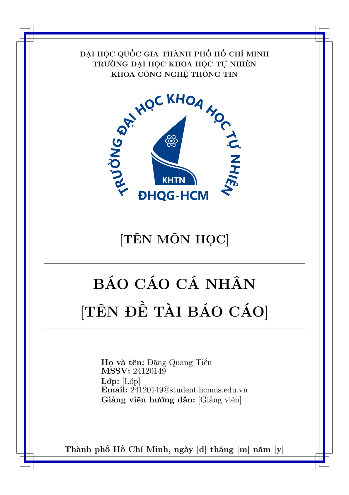

# LaTeX Academic Report Template

[](https://www.latex-project.org/)
[](LICENSE)
[](main.pdf)
[](https://hcmus.edu.vn)

A clean, modular, and publication-ready academic report template configured in LaTeX. Tailored for coursework, lab reports, and technical theses at VNU-HCM University of Science (HCMUS) with out-of-the-box Vietnamese language and mathematical typesetting support.

---

## Features

- **Modular Layout:** Organized into dedicated style definitions (`style/`) and chapter sources (`chapter/`) for seamless team collaboration.
- **Vietnamese Language Support:** Built-in font encoding (T5, utf8) configured through the `vietnam` package.
- **Institutional Cover Page:** TikZ-rendered frame border with institutional logo and formal metadata tables.
- **Reference Management:** Modern citation engine using BibLaTeX with centralized reference storage (`ref.bib`).
- **Cross-Platform Compatibility:** Tested with TeX Live, MiKTeX, Overleaf, and VS Code LaTeX Workshop.

---

## Directory Structure

```text
Report_Template_LaTeX/
├── chapter/
│   └── content.tex         # Main report contents and sections
├── style/
│   ├── config.tex          # Package imports, font configurations, and hyperref
│   ├── cover_page.tex      # TikZ cover page template
│   ├── header_footer.tex   # Fancyhdr header and footer rules
│   └── logo.png            # Institutional logo
├── main.tex                # Document root
├── ref.bib                 # Bibliography entries (BibLaTeX)
├── main.pdf                # Pre-compiled sample output
├── .gitignore
└── LICENSE                 # MIT License
```

---

## Getting Started

### Prerequisites

Install a complete TeX distribution:
- **Windows:** [MiKTeX](https://miktex.org/) or [TeX Live](https://www.tug.org/texlive/)
- **Linux:** `sudo apt install texlive-full`
- **macOS:** [MacTeX](https://www.tug.org/mactex/)
- **Web:** Import this repository directly into [Overleaf](https://www.overleaf.com/).

### Compilation

Compile using `latexmk` or `pdflatex`:

```bash
# Using latexmk (recommended: handles bibliography and references automatically)
latexmk -pdf main.tex

# Using pdflatex manually (run twice for table of contents update)
pdflatex main.tex
biber main
pdflatex main.tex
```

---

## Customization

1. **Cover Page:** Open `style/cover_page.tex` to customize the project title, course name, student credentials, and faculty advisor.
2. **Body Content:** Add or edit sections inside `chapter/content.tex`.
3. **References:** Add your BibTeX citations in `ref.bib` and cite them with `\cite{key}`.

---


---

## Preview

<p align="center">
  
</p>

## License

This project is licensed under the [MIT License](LICENSE).
